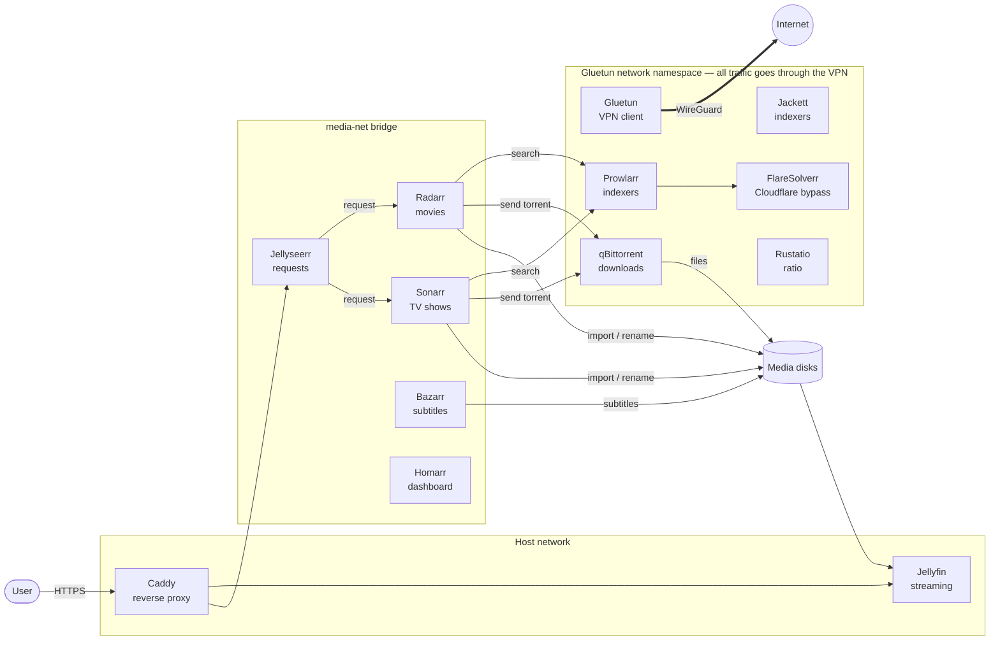

# Ratflix stack

A self-hosted media server built with Docker Compose. It lets you request movies and TV shows, downloads them through a VPN, organizes them, fetches subtitles, and streams everything with Jellyfin. You can watch at home or remotely over HTTPS.

## Architecture



The stack runs in three network zones:

| Zone | Services | Why |
|---|---|---|
| **Gluetun namespace** (`network_mode: service:gluetun`) | Prowlarr, Jackett, FlareSolverr, qBittorrent, Rustatio | All their traffic goes through the VPN tunnel. If the VPN drops, Gluetun's firewall blocks the traffic (kill switch). Their ports are published on the `gluetun` container. |
| **`media-net` bridge** | Radarr, Sonarr, Bazarr, Jellyseerr, Homarr | These services don't need the VPN. They use your normal connection. |
| **Host network** | Jellyfin, Caddy | Jellyfin needs it for DLNA and casting discovery. Caddy needs it to bind ports 80/443 and proxy to `localhost`. |

`FIREWALL_OUTBOUND_SUBNETS` lets the VPN'd services reach your LAN, so Radarr and Sonarr can still talk to qBittorrent and Prowlarr.

## Services

| Service | Role | URL |
|---|---|---|
| [Jellyfin](https://jellyfin.org) | Media server: streams your library to browsers, TVs and phones. Uses `/dev/dri` for hardware transcoding. | `http://SERVER_IP:8096` |
| [Jellyseerr](https://github.com/Fallenbagel/jellyseerr) | Request portal: users browse and request movies or shows, and requests go to Radarr or Sonarr. | `http://SERVER_IP:5055` |
| [Radarr](https://radarr.video) | Movie manager: searches releases, sends them to qBittorrent, then renames and moves finished files into your library. | `http://SERVER_IP:7878` |
| [Sonarr](https://sonarr.tv) | Same as Radarr, for TV shows. | `http://SERVER_IP:8989` |
| [Bazarr](https://www.bazarr.media) | Downloads subtitles for everything Radarr and Sonarr manage. | `http://SERVER_IP:6767` |
| [Prowlarr](https://prowlarr.com) | Indexer manager: configure your torrent sites once and they sync to Radarr and Sonarr. | `http://SERVER_IP:9696` |
| [Jackett](https://github.com/Jackett/Jackett) | Alternative indexer proxy, for sites Prowlarr doesn't support. | `http://SERVER_IP:9117` |
| [FlareSolverr](https://github.com/FlareSolverr/FlareSolverr) | Solves Cloudflare challenges for Prowlarr and Jackett. No UI. | `http://SERVER_IP:8191` |
| [qBittorrent](https://www.qbittorrent.org) | Torrent client. Downloads into `DOWNLOADS_PATH`. | `http://SERVER_IP:8080` |
| [Rustatio](https://github.com/takitsu21/rustatio) | Torrent ratio tool. Syncs with the Gluetun forwarded port through the control server. | `http://SERVER_IP:8090` |
| [Gluetun](https://github.com/qdm12/gluetun) | VPN client (NordVPN over WireGuard by default) with a built-in kill switch. The control server runs on port 8000. | `http://SERVER_IP:8000` |
| [Homarr](https://homarr.dev) | Dashboard with links to all the services. Can see Docker containers. | `http://SERVER_IP:7575` |
| [Caddy](https://caddyserver.com) | Reverse proxy with automatic HTTPS (Let's Encrypt) for Jellyfin and Jellyseerr. | `https://JELLYFIN_DOMAIN`, `https://JELLYSEERR_DOMAIN` |

## Project layout

```
.
├── docker-compose.yml      # Main file: includes every service and defines media-net
├── .env.example            # Template for your local settings and secrets
├── .env                    # Your settings (git-ignored)
├── caddy/Caddyfile         # Reverse proxy rules (domains come from .env)
├── gluetun/gluetun/        # Gluetun data (VPN server lists)
└── <service>/compose.yaml  # One folder per service; its config/ data stays next to it
```

Each service's persistent data (`config/`, `data/`, `cache/`…) lives in its own folder and is git-ignored.

## Installation

### Prerequisites

- Linux with Docker and Docker Compose **v2.20 or later** (needed for `include:`)
- A VPN subscription supported by [Gluetun](https://github.com/qdm12/gluetun-wiki/tree/main/setup/providers)
- For remote access: a domain, DNS `A` records pointing to your public IP, and ports **80** and **443** forwarded to the server
- Optional: an Intel or AMD GPU for Jellyfin hardware transcoding (`/dev/dri`)

### 1. Configure

```bash
git clone <this-repo> ratflix && cd ratflix
cp .env.example .env
chmod 600 .env
nano .env
```

| Variable | Description |
|---|---|
| `PUID` / `PGID` | Your user and group IDs (run `id`). Files are created with these IDs. |
| `TZ` | Time zone, e.g. `Europe/Paris` |
| `MEDIA_PATH`, `DATA_PATH` | Your media disks. They are mounted **at the same path** inside every container, so paths match across Jellyfin, Radarr, Sonarr and Bazarr. |
| `DOWNLOADS_PATH` | Where qBittorrent saves files. Mounted as `/downloads`. |
| `LAN_SUBNET` | Your local network, e.g. `192.168.1.0/24`. Lets VPN'd services reach the LAN. |
| `SERVER_IP` | LAN IP of the server. Used as Jellyfin's published URL. |
| `JELLYFIN_DOMAIN`, `JELLYSEERR_DOMAIN` | Public domains served by Caddy |
| `VPN_SERVICE_PROVIDER`, `VPN_TYPE`, `SERVER_COUNTRIES` | Gluetun settings |
| `WIREGUARD_PRIVATE_KEY` | Your WireGuard key (NordVPN: [how to get it](https://github.com/qdm12/gluetun-wiki/blob/main/setup/providers/nordvpn.md)) |
| `OPENVPN_USER`, `OPENVPN_PASSWORD` | Only if `VPN_TYPE=openvpn` |
| `GLUETUN_API_KEY` | API key for the Gluetun control server. Generate one with `openssl rand -base64 16`. |
| `RUSTATIO_AUTH_TOKEN` | Rustatio UI token. Generate one with `openssl rand -hex 32`. |

### 2. Start

```bash
docker compose up -d
docker compose ps        # every container should be "running" / "healthy"
```

The VPN'd services wait until Gluetun is healthy before starting.

Check that the VPN works. This should print the VPN IP, not your own:

```bash
docker exec gluetun wget -qO- https://ipinfo.io/ip
```

### 3. Connect the services

Services in the Gluetun namespace aren't on `media-net`, so connect them **through the server's LAN IP** (`SERVER_IP`), not by container name. Services that share the Gluetun namespace can reach each other on `localhost`.

1. **qBittorrent**: get the temporary admin password with `docker logs qbittorrent`, log in, and change it. Set the default save path to `/downloads`.
2. **Prowlarr**
   - *Settings → Indexers*: add FlareSolverr as a proxy at `http://localhost:8191`.
   - Add your indexers.
   - *Settings → Apps*: add Radarr (`http://SERVER_IP:7878`) and Sonarr (`http://SERVER_IP:8989`) with their API keys. Set the Prowlarr server to `http://SERVER_IP:9696`.
3. **Radarr / Sonarr**
   - *Settings → Download Clients*: add qBittorrent (host `SERVER_IP`, port `8080`).
   - *Settings → Media Management*: add root folders under `MEDIA_PATH` or `DATA_PATH`.
4. **Bazarr**: connect to Radarr and Sonarr (`SERVER_IP` plus their API keys), then choose languages and subtitle providers.
5. **Jellyfin**: run the setup wizard and add libraries that point to the same folders as Radarr and Sonarr. For hardware transcoding, go to *Dashboard → Playback → Transcoding* and pick VAAPI or QSV.
6. **Jellyseerr**: sign in with Jellyfin (`http://SERVER_IP:8096`), then add Radarr and Sonarr.
7. **Homarr**: add tiles for each service.

## Daily usage

1. Request a movie or show in **Jellyseerr**.
2. Radarr or Sonarr finds a release through Prowlarr and sends it to qBittorrent (through the VPN).
3. When the download finishes, it's imported and renamed into your library, and Bazarr fetches subtitles.
4. Watch it in **Jellyfin**.

## Common commands

```bash
docker compose up -d                      # start / apply changes
docker compose down                       # stop everything
docker compose logs -f <service>          # follow logs
docker compose restart <service>          # restart one service
docker compose pull && docker compose up -d   # update all images
docker image prune -f                     # remove old images
docker compose config                     # check the resolved config (.env included)
```

Query the Gluetun control server:

```bash
source .env
curl -H "X-API-Key: $GLUETUN_API_KEY" http://localhost:8000/v1/publicip/ip
curl -H "X-API-Key: $GLUETUN_API_KEY" http://localhost:8000/v1/openvpn/portforwarded
```

## Adding a service

1. Create `<service>/compose.yaml`.
2. Add it to the `include:` list in `docker-compose.yml`.
3. If it needs the VPN, use `network_mode: service:gluetun` and publish its port on the `gluetun` container. Otherwise, add it to `media-net`.
4. Put any machine-specific or secret value in `.env` and `.env.example`.

## Security notes

- Never commit `.env`. It holds your VPN key and API tokens.
- Only Jellyfin and Jellyseerr are exposed to the internet, through Caddy. Keep the other ports on your LAN.
- Homarr has access to the Docker socket, which is equivalent to root on the host. Don't expose it publicly.
